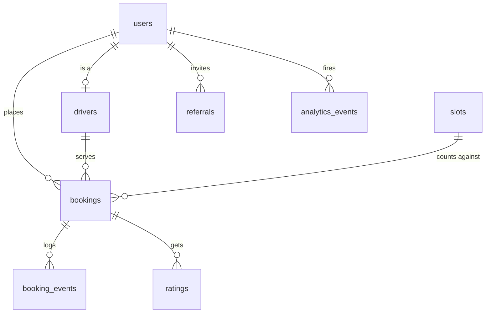

# Chota: technical design

Author: Franklin Magoba · Status: implemented (demo) · Last updated: October 2026

## 0. Background and honesty note

I built the first Chota customer app in Flutter in January 2021. It had the screens (choose service, specify quantity, available trucks, order status, saved locations, bills) but no backend; the data was hard-coded. This document covers the 2026 rebuild: the app moved to current Flutter with null safety and talks to a real backend, and I designed and wrote the backend, the ops dashboard and this plan. The screens keep the original look: white sheets over a full-screen map, grey service circles, the Averta font, and the same illustrations.

This repo is a sanitized example. Everything in it runs on seeded demo data (made-up drivers, plates and phone numbers around Lang'ata and Karen), and it holds no production credentials.

## 1. Problem

In much of Nairobi, piped water is unreliable and many homes are on septic tanks. People get water from trucks and empty tanks with exhauster trucks. Today that means calling a few numbers you got from a neighbour, hoping someone is free, haggling, and waiting with no idea where the truck is. Truck owners have the opposite problem: idle trucks in one estate while another estate is short.

Chota matches the two sides, the way ride-hailing does for cars.

## 2. Users and core jobs

| User | Job | What success looks like |
|---|---|---|
| Customer (household, landlord, small business) | Get N litres of water, or a tank emptied, at a specific gate | Sees free trucks near them, gets a price up front, gets a truck assigned in seconds, can watch it arrive |
| Driver / truck owner | Fill idle time with nearby jobs | Gets jobs close to where they are, never two at once, paid fairly |
| Ops (us) | Keep the marketplace healthy | Sees live demand and supply, can turn features on/off safely, can tell whether a change helped |

## 3. Requirements

Functional
- Show available trucks near a point, updating live.
- Book a truck: service, quantity, pin, address. Assign the nearest suitable free truck.
- Live booking status (assigned, en route, arrived, completed) and live driver position.
- Cancel, rate both ways, trust score.
- Invite codes with a reward that is hard to game.
- Feature flags, experiments, a holdout group, product analytics events.

Non-functional
- A truck is never assigned two active jobs. A customer retrying a request never gets two bookings. We never accept more jobs for a zone and hour than we can serve.
- Booking p95 under 300 ms on normal load.
- API instances are stateless so we can run more than one.
- Basic SLO visibility from day one: uptime, error rate, latency.

Out of scope for this version: payments (M-Pesa), real SMS OTP, the driver app UI (drivers are simulated through the same API a driver app would call), routing along roads.

## 4. Architecture

```mermaid
flowchart LR
  subgraph Clients
    A[Flutter customer app]
    D[Driver app / simulator]
    W[Next.js ops dashboard]
  end
  subgraph API["API instances (Fastify, TypeScript)"]
    R[REST routes]
    S[WebSocket hub]
  end
  PG[(PostgreSQL + PostGIS)]
  RD[(Redis: GEO + pub/sub)]
  P[Prometheus]
  L[LLM API, optional]

  A -- REST + WS --> API
  D -- REST --> API
  W -- REST + WS --> API
  R -- transactions, locks --> PG
  R -- GEOADD / GEOSEARCH --> RD
  R -- PUBLISH --> RD
  RD -- SUBSCRIBE --> S
  S -- push --> A
  S -- push --> W
  P -- scrape /metrics --> API
  R -. status copy, 2.5s timeout .-> L
```

Rules I followed:
- Postgres is the source of truth for anything that matters (bookings, assignment, money, trust). Redis holds things that are fine to lose and rebuild: live positions and fan-out.
- Writes never push to sockets directly. A service publishes to Redis; every API instance subscribes and forwards to the sockets it holds. Adding instances needs no sticky sessions for correctness.
- One booking = one Postgres transaction.

### Code map

```
backend/
  migrations/001_init.sql      schema, constraints, indexes
  src/services/bookings.ts     booking + dispatch transaction, status machine, cancel, rate, referral payout
  src/services/drivers.ts      Redis GEO, location updates, availability sync
  src/services/flags.ts        flags, experiments, holdout (pure functions + cache)
  src/services/trust.ts        trust score (pure function)
  src/services/pricing.ts      price and surge (pure functions)
  src/services/users.ts        login, invite codes, referrals
  src/services/analytics.ts    event allow-list + tracking with assignment snapshot
  src/services/llm.ts          optional LLM status copy with template fallback
  src/realtime.ts              WebSocket hub over Redis pub/sub
  src/lib/metrics.ts           Prometheus metrics
  scripts/                     migrate, seed, simulate-drivers, race-demo
  test/                        unit tests, concurrency tests
mobile/lib/
  core/                        api client, realtime client, state, models, theme
  screens/                     home map, quantity, tracking, rating, invite, orders, sign in
web/app/page.tsx               ops dashboard
```

## 5. Data model



| Table | Key columns | Notes |
|---|---|---|
| `users` | phone (unique), role, invite_code (unique), invited_by, rating_sum/count, completed_jobs, cancelled_jobs, trust_score, credit_kes | Trust inputs are counters; the score is derived |
| `drivers` | user_id, service_type, capacity_litres, status, location (geography), version | GiST index on location; partial index on available drivers |
| `bookings` | customer_id, driver_id, slot_id, service_type, quantity, pickup (geography), status, price_kes, surge_multiplier, idempotency_key, version | `UNIQUE (customer_id, idempotency_key)`; partial unique index: one active booking per driver |
| `booking_events` | booking_id, status, actor_id, at | Append-only history for support and analytics |
| `slots` | zone, service_type, starts_at, capacity, booked | `CHECK (booked <= capacity)` |
| `ratings` | booking_id, rater_id, ratee_id, stars | `UNIQUE (booking_id, rater_id)` |
| `referrals` | inviter_id, invitee_id (unique), status, reward_kes | One inviter per invitee |
| `feature_flags` | key, enabled, rollout_percent, respect_holdout | |
| `experiments` | key, variants (jsonb weights), metric, active | |
| `analytics_events` | user_id, name, props, assignments (jsonb) | Every event carries the flags/variants the user had at that moment |

## 6. Booking and dispatch: locking and race conditions

This is the part that has to be right. The whole thing is `createBooking` in `services/bookings.ts`.

### Flow

```mermaid
sequenceDiagram
  participant App
  participant API
  participant Redis
  participant PG as Postgres
  App->>API: POST /bookings (Idempotency-Key)
  API->>PG: existing booking for (customer, key)? return it
  API->>Redis: GEOSEARCH nearest available trucks (hint only)
  API->>PG: BEGIN
  API->>PG: INSERT booking ... ON CONFLICT (customer, key) DO NOTHING
  API->>PG: SELECT driver WHERE id = ANY(candidates) AND status='available' ORDER BY distance FOR UPDATE SKIP LOCKED LIMIT 1
  API->>PG: UPDATE slots SET booked=booked+1 WHERE booked < capacity
  API->>PG: UPDATE drivers SET status='busy'; UPDATE booking SET driver, price
  API->>PG: COMMIT
  API->>Redis: ZREM truck from GEO set, PUBLISH booking update
  API-->>App: 201 booking
```

### The races and how each is handled

| Race | What would go wrong | Guard |
|---|---|---|
| Customer double-taps, or the app retries after a timeout | Two bookings, two trucks dispatched, double charge | Client makes one UUID per order attempt and reuses it on network-error retries. DB has `UNIQUE (customer_id, idempotency_key)`. Concurrent duplicates block on the unique index; the loser hits `ON CONFLICT DO NOTHING` and returns the winner's booking with `200` and `idempotent-replayed: true`. |
| Two customers want the same nearest truck at the same moment | Truck assigned twice | `SELECT ... FOR UPDATE SKIP LOCKED`. The second transaction skips the locked row and takes the next-nearest truck instead of waiting behind the first one. Nobody blocks, nobody double-books. |
| Redis says a truck is free but it just got a job | Stale hint | Redis is only a candidate list. The row lock re-checks `status = 'available'` inside the transaction. |
| A bug somewhere bypasses the above | Double booking | Partial unique index `bookings(driver_id) WHERE status IN ('assigned','en_route','arrived')`. The DB refuses it; the API maps the violation to `409 CONFLICT`. |
| Surge: 200 requests for 30 trucks in one estate at 7am | Oversold capacity, angry customers | Slot row per zone/service/hour. `UPDATE slots SET booked = booked + 1 WHERE ... AND booked < capacity`. The row lock serialises the counter, and the `CHECK (booked <= capacity)` constraint backs it up. Losers get `409 SLOT_FULL` and a clear message, and their booking insert rolls back. |
| Driver marks "en route" just as the customer cancels | Overwriting a cancellation | Optimistic versioning: the driver sends the version it saw; `UPDATE ... WHERE id = $1 AND version = $2`. Zero rows means someone else changed it; return `409 STALE_VERSION`. |
| Two ratings land at once | Lost update on trust counters | Counters are incremented in SQL, and trust is recomputed under `SELECT ... FOR UPDATE` on the user row. |
| Referral reward paid twice | Free money | Reward paid by `UPDATE referrals SET status='rewarded' WHERE invitee_id=$1 AND status='pending'`. Only one transaction can flip it. |

Why `SKIP LOCKED` over a pure optimistic approach for assignment: with optimistic versioning, in a surge every request races for the same nearest truck and all but one retry, which turns into a retry storm exactly when load is highest. `SKIP LOCKED` lets each request take the next truck in one pass. I still use optimistic versions for status transitions, where conflicts are rare and a 409 to the client is the right answer.

Lock ordering: inside the transaction we always lock the driver row before the slot row, so two booking transactions can't deadlock on each other. Cancel touches slot then driver, but it only ever locks one driver and one slot that the booking already owns, and no booking transaction can be waiting on a busy driver's row (it filters on `status='available'` and skips locked rows).

### Proof

`backend/test/concurrency.test.ts` runs against real Postgres and Redis:
- 30 customers, 1 truck, all at once: exactly 1 assigned, 29 `no_driver`, 1 active booking for the truck.
- 10 customers, 10 trucks: 10 distinct trucks.
- Same idempotency key 15 times at once: 1 booking, 1 busy truck.
- Slot capacity 4, 12 trucks, 12 requests: 4 accepted, 8 `SLOT_FULL`, 8 trucks still free, surge 1.5x on the last ones.
- Driver update after a cancel: rejected with 409, truck released.

`npm run race` does the same against the running API so it can be shown live.

## 7. Real-time design

- One WebSocket per app session at `/ws?token=<jwt>`. The client sends `subscribe_nearby {lat,lng,service}` and `subscribe_booking {bookingId}`. Ops sends `subscribe_ops`.
- Three Redis channels: `chota:driver_location`, `chota:availability`, `chota:booking`. Every API instance subscribes to all three and filters per socket: nearby subscribers get trucks within the dispatch radius for their service; booking subscribers get updates only for bookings they own (checked on subscribe).
- Booking messages carry the full booking with its `version`. The app drops any message older than what it has, so out-of-order delivery is harmless.
- The app reconnects with exponential backoff and replays its subscriptions. After subscribing to a booking it also does one REST fetch, which covers anything published before the subscription was in place.
- Why WebSockets and not SSE: the client needs to change its subscription (moving the pin, opening a booking) without reconnecting. SSE would work for the ops dashboard alone.
- Pub/sub is fire-and-forget. A missed message is fixed by the next location tick (every 2 s) or the REST catch-up. If we needed guaranteed delivery (for example push notifications), I'd move booking events to Redis Streams or a queue.

## 8. Geo design

- Hot path: Redis GEO, one sorted set per service (`chota:drivers:geo:water`, `...:sewage`). Only available trucks are in the set, so "nearby" means "bookable". `GEOSEARCH ... BYRADIUS 8 km ASC COUNT 25` is sub-millisecond.
- Positions are also written to `drivers.location` (PostGIS geography, GiST index). If Redis is empty (cold start, flush), dispatch falls back to `ST_DWithin` + `ORDER BY location <-> point`, which uses the index.
- Status changes keep the two in step: busy or offline means `ZREM`, available means `GEOADD`.
- Zones for capacity are a simple 0.05° grid (about 5.5 km). Good enough for a demo; in production I'd use H3 cells so zones are equal-area and can be tuned per estate.
- ETA is straight-line distance at 25 km/h plus 3 minutes. Honest about it in the UI ("about"). A routing engine (OSRM) is the next step.

## 9. Invites and trust

Invites
- Every user gets a 8-character code (no 0/O/1/I, since people read them out over the phone).
- A code can be entered at sign-up, or later but only before the first order.
- The reward (KES 200 each, behind `referral_rewards`) is paid on the invitee's first completed order, not on sign-up. A fake account has to actually order and pay for a truck to earn anything.
- Limits: one inviter per invitee, no self-invites, at most 20 pending invites per code.
- Events: `invite_shared`, `invite_redeemed`, `referral_rewarded`, so we can measure the k-factor.

Trust score (0 to 100, `services/trust.ts`)
- 60% rating, as a Bayesian average with a prior of 5 ratings at 4.0 stars. One early review can't push a new driver to 100 or to 0.
- 25% reliability: completed / (completed + cancelled), with a prior too.
- 15% experience: log scale on completed jobs, saturating around 100.
- Applies to both sides: customers who cancel after assignment lose reliability.
- Used today for the trust badge on the tracking screen (behind `trust_badge`, 50% rollout). Next step is to use it in dispatch as a tie-breaker between trucks at similar distance, and to gate cash-on-delivery for low-trust customers.

## 10. Feature flags, experiments and holdouts

- Bucketing: `sha256(salt + ":" + userId)`, first 4 bytes mod 10000. Deterministic, no assignment table needed, same answer on every instance.
- Flags: on if `enabled` and `bucket("flag:<key>") < rollout% × 100`. Raising the percentage only adds users; nobody flips off and on (there's a test for this).
- Global holdout: 5% of users (`bucket("global-holdout")`) get no flagged features and always see control in experiments. Comparing them with everyone else tells us the combined effect of everything we've shipped, which per-experiment A/B tests can't. Flags that must reach everyone (safety, legal) set `respect_holdout = false`.
- Experiments: weighted variants, separate salt per experiment so assignments are independent of flags and of each other. Running now: `request_button_copy` ("Request truck" vs "Get water now"), metric `booking_created`.
- Every analytics event stores the user's assignment snapshot at that moment. Analysis is a `GROUP BY` on `assignments->'experiments'->>key`; `/ops/experiments/:key/results` does exactly that and the dashboard shows it.
- Flags are cached in-process for 5 seconds; a flag change from the dashboard invalidates that instance's cache immediately and others within 5 seconds.
- What this doesn't do yet: significance testing, sample-ratio-mismatch checks, exposure logging separate from events. For real decisions I'd export events to a warehouse and use a stats tool, or move to GrowthBook/Statsig, and keep the same bucketing.

## 11. Observability

- `/metrics` (Prometheus):
  - `chota_http_request_duration_seconds{method,route,status}` histogram: latency and request rate per route.
  - `chota_http_errors_total{route,class}`: 4xx and 5xx counts.
  - `chota_uptime_seconds`, plus default process metrics (CPU, memory, event loop lag, GC).
  - `chota_bookings_created_total{service,outcome}`: assigned, no_driver, slot_full. The no_driver rate is the main marketplace health signal.
  - `chota_dispatch_duration_seconds`: time inside the booking transaction. If lock contention grows, this shows it first.
  - `chota_ws_connections`.
- `/health` is liveness (process up). `/ready` checks Postgres and Redis and returns 503 if either is down, so a load balancer stops sending traffic.
- Structured JSON logs (Fastify/pino) with request ids.
- SLOs I'd start with: 99.5% of booking requests succeed (non-5xx), p95 booking latency < 300 ms, no_driver rate < 15% in served zones. Alerts on burn rate, not raw thresholds.
- Product analytics: allow-listed event names (`EVENT_NAMES`), so typos don't create junk events. The funnel is `service_selected → quantity_selected → booking_requested → booking_created → booking_completed → rating_submitted`.

## 12. LLM use (optional)

`GET /bookings/:id/message` returns one status line for the tracking screen, in English or Swahili. Behind `llm_status_copy` (off by default, 10% when on). It calls an OpenAI-compatible API with a 2.5 s timeout and falls back to templates on any error, timeout or missing key. The booking flow never waits on it. It's a small use on purpose: low risk, easy to measure, easy to turn off. A more valuable next use is triaging support messages ("driver didn't come", "wrong quantity") into structured tickets.

## 13. Scaling notes

- API: stateless; scale horizontally. WebSocket fan-out is per instance via Redis pub/sub, which is fine to tens of thousands of sockets. Past that, shard channels by zone (`chota:driver_location:<zone>`) so instances only receive what their clients need.
- Postgres: booking transactions are short (a handful of indexed statements). Contention is per truck and per slot row, not global. Hot slot rows in a surge are the first bottleneck; if needed, split capacity into N sub-counters per slot and pick one at random.
- Location writes: every 2 s per truck is about 0.5 writes/s per truck. 2,000 trucks is 1,000 writes/s, which Redis handles easily. The Postgres location write is the one to drop first: write it every 30 s, or batch.
- Analytics events: in the main DB for now. Next step is to write them to a queue and load into a warehouse so product queries never touch the booking DB.
- Read replicas for ops/dashboard queries.

## 14. Tradeoffs I made

| Decision | Why | Cost |
|---|---|---|
| Redis GEO + PostGIS fallback | Fast hot path, durable fallback | Two stores to keep in sync on status changes |
| `SKIP LOCKED` for assignment | No retry storms in a surge | The nearest truck isn't always picked if it's locked mid-transaction; the second-nearest is |
| Assign at request time, no driver accept step | Simplest flow that works for a demo; many water truck owners prefer auto-assign | Real drivers need accept/decline with a timeout and re-dispatch |
| Hour-long slots per zone | Easy to reason about and to explain to truck owners | Coarse. A rolling window would smooth demand better |
| Surge capped at 1.5x | Water is essential; better to say "full" than to price people out | Less supply incentive at peaks |
| Hash bucketing, no assignment table | Zero writes, consistent across instances | Can't hand-pick users into a variant without an override list |
| OpenStreetMap tiles instead of Google Maps (the 2021 app used Google) | No API key needed to run the demo | Fewer POIs and no Places autocomplete |
| Phone-only login (OTP stubbed) | Out of scope for the demo | Not production auth |

## 15. What I'd do next

1. Driver app with accept/decline, timeout and re-dispatch to the next truck.
2. M-Pesa STK push, with payment held until completion; a payments table with its own idempotency keys.
3. Real OTP via Africa's Talking, rate limited per phone and per IP.
4. Road routing and ETAs with OSRM; H3 zones.
5. Scheduled bookings ("tomorrow 7am"), which slots already support.
6. Trust in dispatch, plus fraud rules on referrals (device fingerprint, same-pin detection).
7. Redis Streams for booking events so offline clients and push notifications don't miss updates.
8. Experiment analysis with significance testing and SRM checks.

## 16. JD requirement map

| Requirement | Where it lives |
|---|---|
| Flutter | `mobile/` (Flutter 3.35, Dart 3, null safety, `flutter analyze` clean) |
| Node.js + TypeScript | `backend/src` (Fastify 5, strict TypeScript, zod validation) |
| PostgreSQL | `backend/migrations/001_init.sql`, PostGIS geography, partial indexes, check constraints |
| Redis | `backend/src/lib/redis.ts`, `services/drivers.ts` (GEO), `realtime.ts` (pub/sub) |
| React / Next.js | `web/app/page.tsx` ops dashboard |
| Real-time availability | Redis GEO + `driver_location`/`availability` channels → `mobile/lib/screens/home_map_screen.dart` |
| High-demand bookings | Slot capacity + surge in `services/bookings.ts` (`reserveSlot`), `services/pricing.ts` |
| Location-aware features | GEOSEARCH, PostGIS fallback, map, pin, live driver position, ETA (`lib/geo.ts`) |
| Invite and trust systems | `services/users.ts`, `maybeRewardReferral` in `bookings.ts`, `services/trust.ts`, `mobile/lib/screens/invite_screen.dart` |
| Transactions, locking, race conditions | `createBooking`, `advanceBooking`, `cancelBooking` in `services/bookings.ts`; section 6; `test/concurrency.test.ts`; `scripts/race-demo.ts` |
| WebSockets / pub-sub | `src/realtime.ts`, `mobile/lib/core/realtime.dart`, dashboard WS |
| Instrumentation / analytics events | `services/analytics.ts`, `POST /events`, app `api.track(...)` calls |
| Experiments / A/B tests | `services/flags.ts` `variantFor`, `request_button_copy` in `quantity_screen.dart`, `/ops/experiments/:key/results` |
| Holdouts | `inHoldout` in `services/flags.ts`, `schema_settings.holdout_percent` |
| Feature flags | `feature_flags` table, `FlagService`, dashboard toggles and rollout sliders |
| Uptime / errors / latency | `src/lib/metrics.ts`, `/metrics`, `/health`, `/ready` |
| Written technical plans | This document |
| Marketplace / booking | The whole product: customers, trucks, dispatch |
| Maps / location | `flutter_map` + OSM, geolocator, Redis GEO, PostGIS |
| LLM in production | `services/llm.ts` behind `llm_status_copy`, with timeout and fallback |
| Tests | `backend/test/unit.test.ts`, `backend/test/concurrency.test.ts`, `mobile/test/models_test.dart` |
